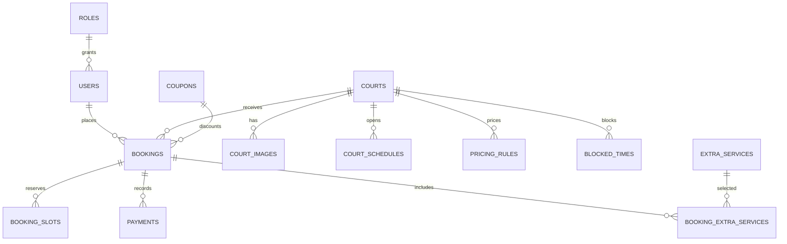

# PickleBook

PickleBook là ứng dụng đặt sân pickleball bằng tiếng Việt, chạy trên Spring Boot 3, Java 17, Thymeleaf và Spring Data JPA. Múi giờ nghiệp vụ là `Asia/Ho_Chi_Minh`; giá hiển thị bằng VNĐ.

Giao diện hiện dùng Thymeleaf theo quyết định giữ kiến trúc đang chạy; dự án không có frontend React/Node nên không cần `npm install` hoặc `npm run dev`.

## Yêu cầu

- JDK 17 trở lên
- Windows PowerShell hoặc shell tương thích Maven Wrapper
- MySQL 8 khi chạy profile `mysql` (không cần MySQL khi chạy profile mặc định `dev`)

Kiểm tra Java:

```powershell
java -version
```

## Chạy lần đầu

Profile mặc định `dev` dùng H2 dạng file tại `./data/picklebook`; dữ liệu được giữ lại sau khi dừng ứng dụng. Flyway tạo schema, nạp dữ liệu demo và áp dụng migration khi khởi động:

```powershell
.\mvnw.cmd clean test
.\mvnw.cmd spring-boot:run
```

Mở [http://localhost:8081](http://localhost:8081). H2 Console ở `/h2-console` (JDBC URL: `jdbc:h2:file:./data/picklebook`, user `sa`, mật khẩu để trống).

Tài khoản phát triển trong `src/main/resources/db/data.sql`:

| Vai trò | Email | Mật khẩu |
|---|---|---|
| Quản trị | `admin@picklebook.vn` | `Admin@123` |
| Nhân viên | `staff@picklebook.vn` | `Staff@123` |
| Khách hàng | `user@picklebook.vn` | `User@123` |

Không sử dụng tài khoản/mật khẩu mẫu này trong môi trường thật.

## Chạy với MySQL 8

Tạo database UTF-8 hoặc để cấu hình tạo database tự động:

```sql
CREATE DATABASE picklebook CHARACTER SET utf8mb4 COLLATE utf8mb4_unicode_ci;
```

Thiết lập biến môi trường (PowerShell):

```powershell
$env:DB_HOST = "localhost"
$env:DB_PORT = "3306"
$env:DB_NAME = "picklebook"
$env:DB_USERNAME = "root"
$env:DB_PASSWORD = "your-local-password"
.\mvnw.cmd spring-boot:run "-Dspring-boot.run.profiles=mysql"
```

Flyway chạy các migration trong `src/main/resources/db/migration`. Khi kết nối tới schema cũ đã có dữ liệu mà chưa có `flyway_schema_history`, cấu hình sẽ ghi baseline phiên bản 2 rồi chạy migration mới hơn để giữ bảng/đơn cũ và gắn sân hiện hữu vào cơ sở. Hãy sao lưu MySQL trước lần nâng cấp đầu tiên. Hai địa chỉ cơ sở được thêm khi chuyển đổi là dữ liệu minh họa; cần cập nhật địa chỉ, hotline và giờ hoạt động thật trước khi công khai website.

## Email

Email bị tắt theo mặc định trong môi trường phát triển. Để bật SMTP, cấu hình các biến môi trường sau:

```powershell
$env:MAIL_ENABLED = "true"
$env:MAIL_HOST = "smtp.gmail.com"
$env:MAIL_PORT = "587"
$env:MAIL_USERNAME = "your-smtp-account"
$env:MAIL_PASSWORD = "your-smtp-app-password"
$env:MAIL_FROM = "PickleBook <no-reply@example.com>"
$env:APP_BASE_URL = "http://localhost:8081"
```

Không ghi thông tin SMTP vào mã nguồn hoặc commit mật khẩu.

## Chức năng hiện có

- Đăng ký, đăng nhập, đăng xuất, quên/đặt lại mật khẩu, hồ sơ và đổi mật khẩu.
- Xem sân và thông tin sân; kiểm tra slot khả dụng theo ngày, giá, giờ mở cửa, buffer, giới hạn báo trước, bảo trì và slot đã giữ.
- Đặt sân với kiểm tra xung đột trong transaction, lưu phương thức thanh toán mô phỏng, tạo mã đơn và trang xác nhận.
- Xem lịch sử/chi tiết đơn; hủy và đổi lịch trong giới hạn chính sách; liên kết quản lý đơn dùng token.
- Scheduler xử lý đơn chờ quá hạn, hoàn thành đơn đã qua giờ và gửi nhắc lịch khi email được bật.
- Khu vực nhân viên/quản trị: dashboard, lọc và phân trang đơn, cập nhật trạng thái hợp lệ, xuất CSV; quản trị viên có thể tìm/lọc, tạo/sửa/khóa tài khoản và đặt lại mật khẩu.
- Quản trị viên thêm/sửa sân, chọn cơ sở, loại/trạng thái sân, giá cơ bản, tiện ích, giới hạn đặt và giờ mở/đóng theo từng ngày; có thể tạm ngưng nhận đặt mà không xóa lịch sử.
- Khách lọc sân theo cơ sở, xem địa chỉ và giờ hoạt động trước khi chọn lịch.
- RBAC, CSRF, BCrypt, giới hạn thử đăng nhập và ghi audit log cho thao tác có hỗ trợ.

## Phạm vi còn cần hoàn thiện

Các trang quản trị CRUD cho cơ sở, ảnh sân, thời gian chặn, giá chi tiết, coupon, dịch vụ, câu hỏi, email template, banner/tin tức và cấu hình chung chưa được triển khai đầy đủ. Giờ hoạt động hiện quản lý theo từng sân; lịch ngày nghỉ đặc biệt và lịch sân dạng calendar vẫn cần làm. Dashboard hiện chưa có biểu đồ/tỷ lệ lấp đầy; quản trị đơn chưa có tạo thủ công, lịch calendar hoặc đổi lịch hộ khách. Thanh toán mới dừng ở mô phỏng phương thức/trạng thái, chưa có tích hợp ngân hàng/cổng thanh toán. Email phụ thuộc cấu hình SMTP và chưa có bảo đảm gửi thực tế khi SMTP không được cấu hình.

## Kiểm thử

```powershell
.\mvnw.cmd clean test
```

Các test hiện kiểm tra sinh slot/giá theo lịch, chuyển trạng thái và render các trang quản trị chính trong profile H2. Cần chạy thêm kiểm thử end-to-end trên MySQL và kiểm thử có tài khoản SMTP thực trước khi triển khai.

## Cấu trúc dữ liệu

Schema được định nghĩa tại `src/main/resources/db/schema.sql`, dữ liệu phát triển tại `src/main/resources/db/data.sql`.



Danh sách URL/use case và ERD chi tiết: [`docs/01-analysis.md`](docs/01-analysis.md) và [`docs/02-erd.md`](docs/02-erd.md).
