# PickleBook – ERD & Kiến trúc (Bước 2)

---

## 1. ERD tổng thể

```mermaid
erDiagram
    ROLES ||--o{ USERS : "phân vai"
    USERS ||--o{ BOOKINGS : "đặt"
    USERS ||--o{ AUDIT_LOGS : "thực hiện"
    USERS ||--o{ PASSWORD_RESET_TOKENS : "sở hữu"

    BRANCHES ||--o{ COURTS : "quản lý"
    BRANCHES ||--o{ SLOT_TEMPLATES : "cấu hình khung giờ"
    BRANCHES ||--o{ PRICING_RULES : "áp dụng giá"
    COURTS ||--o{ COURT_IMAGES : "có"
    COURTS ||--o{ COURT_SCHEDULES : "mở cửa"
    COURTS ||--o{ BLOCKED_TIMES : "bị chặn"
    COURTS ||--o{ PRICING_RULES : "định giá"
    COURTS ||--o{ BOOKINGS : "được đặt"
    COURTS ||--o{ BOOKING_SLOTS : "gồm"

    BOOKINGS ||--|{ BOOKING_SLOTS : "chi tiết giờ"
    BOOKINGS ||--o{ PAYMENTS : "thanh toán"
    BOOKINGS ||--o{ BOOKING_EXTRA_SERVICES : "dịch vụ thêm"
    BOOKINGS ||--o{ BOOKING_ANSWERS : "trả lời"
    COUPONS ||--o{ BOOKINGS : "áp dụng"
    EXTRA_SERVICES ||--o{ BOOKING_EXTRA_SERVICES : "được chọn"
    CUSTOM_QUESTIONS ||--o{ BOOKING_ANSWERS : "hỏi"

    ROLES {
        bigint id PK
        varchar name UK "ROLE_ADMIN / ROLE_STAFF / ROLE_USER"
        varchar description
    }

    BRANCHES {
        bigint id PK
        varchar name
        varchar slug UK
        varchar address
        varchar district
        varchar city
        varchar phone
        varchar email
        varchar timezone
        varchar status
    }

    USERS {
        bigint id PK
        varchar full_name
        varchar email UK
        varchar phone
        varchar password_hash
        varchar avatar_url
        bigint role_id FK
        varchar status "ACTIVE / LOCKED"
        datetime last_login_at
        datetime created_at
        datetime updated_at
    }

    PASSWORD_RESET_TOKENS {
        bigint id PK
        bigint user_id FK
        varchar token_hash UK
        datetime expires_at
        datetime used_at
        datetime created_at
    }

    COURTS {
        bigint id PK
        varchar name
        varchar slug UK
        text description
        varchar court_type "INDOOR / OUTDOOR"
        varchar status "ACTIVE / MAINTENANCE / HIDDEN"
        decimal base_price "giá mặc định mỗi giờ"
        int slot_minutes "30 / 60 / 90"
        int buffer_minutes
        int min_notice_minutes
        int max_advance_days
        int max_slots_per_booking
        int sort_order
        datetime created_at
        datetime updated_at
    }

    COURT_IMAGES {
        bigint id PK
        bigint court_id FK
        varchar image_url
        varchar alt_text
        boolean is_primary
        int sort_order
    }

    COURT_SCHEDULES {
        bigint id PK
        bigint court_id FK
        smallint day_of_week "1=T2 .. 7=CN"
        time open_time
        time close_time
        boolean closed
    }

    SLOT_TEMPLATES {
        bigint id PK
        bigint branch_id FK
        varchar day_type
        time start_time
        time end_time
        varchar period_name
        boolean active
        int sort_order
    }

    BLOCKED_TIMES {
        bigint id PK
        bigint court_id FK "NULL = toàn hệ thống"
        varchar block_type "HOLIDAY / MAINTENANCE / EVENT"
        varchar title
        datetime start_at
        datetime end_at
        boolean affects_pricing "đánh dấu ngày lễ cho bảng giá"
        bigint created_by FK
        datetime created_at
    }

    PRICING_RULES {
        bigint id PK
        bigint branch_id FK
        bigint court_id FK "NULL = áp dụng mọi sân"
        varchar day_type "WEEKDAY / WEEKEND / HOLIDAY"
        time start_time
        time end_time
        decimal price_per_hour
        int priority
        boolean active
    }

    COUPONS {
        bigint id PK
        varchar code UK
        varchar discount_type "PERCENT / FIXED"
        decimal discount_value
        decimal min_order_amount
        decimal max_discount
        datetime valid_from
        datetime valid_to
        int usage_limit
        int used_count
        boolean active
    }

    EXTRA_SERVICES {
        bigint id PK
        varchar name
        varchar description
        decimal price
        varchar unit "lần / bộ / giờ"
        boolean active
        int sort_order
    }

    CUSTOM_QUESTIONS {
        bigint id PK
        varchar label
        varchar field_type "TEXT / NUMBER / SELECT / CHECKBOX"
        text options_json
        boolean required
        boolean active
        int sort_order
    }

    BOOKINGS {
        bigint id PK
        varchar booking_code UK
        bigint user_id FK
        bigint court_id FK
        varchar customer_name
        varchar customer_phone
        varchar customer_email
        int player_count
        text note
        datetime start_at
        datetime end_at
        decimal slot_amount
        decimal extra_amount
        decimal discount_amount
        decimal final_amount
        bigint coupon_id FK
        varchar status "PENDING / CONFIRMED / COMPLETED / CANCELLED / NO_SHOW"
        varchar payment_status "UNPAID / DEPOSIT_PAID / PAID / REFUNDED"
        varchar payment_method "CASH / BANK_TRANSFER / ONLINE"
        varchar manage_token_hash UK
        datetime reminder_sent_at
        datetime cancelled_at
        varchar cancel_reason
        bigint created_by FK "NULL = khách tự đặt"
        bigint version "optimistic lock"
        datetime created_at
        datetime updated_at
    }

    BOOKING_SLOTS {
        bigint id PK
        bigint booking_id FK
        bigint court_id FK
        datetime start_at
        datetime end_at
        decimal price
        integer active_key "1 = đang giữ, NULL = đã giải phóng"
    }

    BOOKING_EXTRA_SERVICES {
        bigint id PK
        bigint booking_id FK
        bigint extra_service_id FK
        int quantity
        decimal unit_price
        decimal amount
    }

    BOOKING_ANSWERS {
        bigint id PK
        bigint booking_id FK
        bigint question_id FK
        text answer
    }

    PAYMENTS {
        bigint id PK
        bigint booking_id FK
        decimal amount
        varchar method "CASH / BANK_TRANSFER / ONLINE"
        varchar status "PENDING / SUCCESS / FAILED / REFUNDED"
        varchar proof_image_url
        varchar transaction_ref
        datetime paid_at
        varchar note
        datetime created_at
    }

    EMAIL_TEMPLATES {
        bigint id PK
        varchar code UK
        varchar name
        varchar subject
        text body_html
        boolean active
        datetime updated_at
    }

    SITE_SETTINGS {
        bigint id PK
        varchar setting_key UK
        text setting_value
        varchar setting_group
        varchar description
    }

    BANNERS {
        bigint id PK
        varchar title
        varchar image_url
        varchar link_url
        int sort_order
        boolean active
    }

    NEWS_POSTS {
        bigint id PK
        varchar slug UK
        varchar title
        text summary
        text content
        varchar thumbnail_url
        varchar status "DRAFT / PUBLISHED"
        datetime published_at
        datetime created_at
    }

    AUDIT_LOGS {
        bigint id PK
        bigint user_id FK
        varchar action "CREATE / UPDATE / DELETE / LOGIN / STATUS_CHANGE"
        varchar entity_name
        bigint entity_id
        text description
        varchar ip_address
        datetime created_at
    }
```



> `site_settings` là bảng key–value nên không có quan hệ FK; các khóa quan trọng:
> `site.name`, `site.logo`, `site.address`, `site.phone`, `site.email`, `site.facebook`,
> `booking.cancel_before_hours`, `booking.reschedule_before_hours`, `booking.deposit_percent`,
> `booking.reminder_hours`, `booking.pending_timeout_minutes`, `mail.from`, `mail.host`...

---

## 2. Từ điển dữ liệu & ràng buộc quan trọng

### 2.1 Khóa & UNIQUE
| Bảng | Ràng buộc | Mục đích |
|---|---|---|
| `users` | `UNIQUE(email)` | 1 email = 1 tài khoản |
| `courts` | `UNIQUE(slug)` | URL thân thiện |
| `bookings` | `UNIQUE(booking_code)` | tra cứu đơn |
| `bookings` | `UNIQUE(manage_token_hash)` | link hủy/đổi trong email |
| `booking_slots` | **`UNIQUE(court_id, start_at, active_key)`** | **chống 2 người đặt cùng giờ** |
| `coupons` | `UNIQUE(code)` | mã giảm giá |
| `email_templates` | `UNIQUE(code)` | mã template |
| `site_settings` | `UNIQUE(setting_key)` | cấu hình |
| `news_posts` | `UNIQUE(slug)` | URL bài viết |
| `court_schedules` | `UNIQUE(court_id, day_of_week)` | 1 cấu hình/thứ/sân |
| `password_reset_tokens` | `UNIQUE(token_hash)` | token 1 lần |

### 2.2 Cơ chế chống đặt trùng (quan trọng nhất)
- Mỗi khung giờ đã đặt sinh 1 hàng `booking_slots` với `active_key = 1`.
- Khi hủy/đổi lịch: đặt `active_key = NULL` → hàng vẫn còn để lưu lịch sử nhưng **không còn tham gia UNIQUE**
  (MySQL cho phép nhiều giá trị NULL trong unique index).
- Khi tạo đơn, service:
  1. `SELECT ... FOR UPDATE` trên hàng `courts` (khóa bi quan) để tuần tự hóa các đơn cùng sân.
  2. Kiểm tra lại toàn bộ slot với DB (không tin dữ liệu client).
  3. `INSERT` các `booking_slots`.
  4. Nếu DB ném `DataIntegrityViolationException` (unique) → rollback + trả lỗi thân thiện.
- `Booking` có thêm `@Version` để phát hiện cập nhật đồng thời ở tầng JPA.

### 2.3 Index đề xuất
```sql
CREATE INDEX idx_bookings_court_start   ON bookings(court_id, start_at);
CREATE INDEX idx_bookings_status_start  ON bookings(status, start_at);
CREATE INDEX idx_bookings_user_created  ON bookings(user_id, created_at DESC);
CREATE INDEX idx_slots_booking          ON booking_slots(booking_id);
CREATE INDEX idx_blocked_court_time     ON blocked_times(court_id, start_at, end_at);
CREATE INDEX idx_pricing_court_day      ON pricing_rules(court_id, day_type);
CREATE INDEX idx_audit_created          ON audit_logs(created_at DESC);
CREATE INDEX idx_users_role_status      ON users(role_id, status);
```

### 2.4 Kiểu dữ liệu & thời gian
- Tiền: `DECIMAL(12,0)` (VNĐ, không phần lẻ) — Java `BigDecimal`.
- Thời gian: `DATETIME` lưu theo `Asia/Ho_Chi_Minh` (single-tenant, một cơ sở).
  Khi hibernate chạy, đặt `hibernate.jdbc.time_zone=Asia/Ho_Chi_Minh`; Java dùng `LocalDateTime` cho
  slot/booking và `Instant` cho log.
- `created_at/updated_at`: `@CreationTimestamp` / `@UpdateTimestamp`.

### 2.5 Enum Java tương ứng
`RoleName`, `UserStatus`, `CourtType`, `CourtStatus`, `BlockType`, `DayType`,
`BookingStatus`, `PaymentStatus`, `PaymentMethod`, `PaymentTxnStatus`, `DiscountType`,
`QuestionType`, `NewsStatus`, `EmailTemplateCode`, `AuditAction`.

---

## 3. Kiến trúc phân tầng

```
Controller (web / admin / api)
    ↓ DTO (request/response/form) + Bean Validation
Service interface → ServiceImpl (@Transactional, business rules)
    ↓ Entity / Repository (Spring Data JPA)
MySQL 8
```

- Controller **không** trả Entity ra view; luôn map sang DTO/View model.
- Mapper thủ công (`@Component`) thay vì reflection để dễ debug, tránh phụ thuộc nặng.
- Exception nghiệp vụ: `BusinessException` (message hiển thị được), `SlotUnavailableException`,
  `ResourceNotFoundException`; `GlobalExceptionHandler` (`@ControllerAdvice`) bắt tập trung.
- Scheduler tách riêng: `ReminderScheduler`, `BookingLifecycleScheduler`.
- Security: `SecurityConfig`, `CustomUserDetailsService`, `SecurityUtils`, `TokenService`.

### Luồng chính khi đặt sân
1. `GET /dat-san` → `SlotService.generateSlots(courtId, date)` trả danh sách slot + trạng thái + giá.
2. Client chọn slot → `POST /api/booking/quote` → `PricingService.quote(...)` trả tạm tính.
3. `POST /dat-san` → `BookingService.create(...)`:
   validate → khóa sân → kiểm tra trùng → tính giá server-side → lưu booking + slots + extras + answers
   → trừ coupon → tạo payment (nếu chọn) → gửi email (sau commit) → trả `bookingCode`.
4. Redirect `/dat-san/thanh-cong/{code}`.

---

## 4. Cấu trúc thư mục dự án

```
picklebook/
├── pom.xml
├── mvnw / mvnw.cmd / .mvn/wrapper/
├── README.md
├── docs/
│   ├── 01-analysis.md
│   └── 02-erd.md
├── src/main/java/com/picklebook/
│   ├── PickleBookApplication.java
│   ├── config/
│   │   ├── SecurityConfig.java          # form login, RBAC, CSRF, BCrypt
│   │   ├── WebMvcConfig.java            # static uploads, interceptor, locale, zone
│   │   ├── MailConfig.java              # JavaMailSender theo site_settings/env
│   │   ├── DataInitializer.java         # seed role + admin (profile dev)
│   │   └── OpenApiConfig.java           # (tùy chọn) mô tả API JSON
│   ├── controller/
│   │   ├── web/  HomeController, CourtController, BookingController,
│   │   │        AuthController, PasswordResetController, MyBookingController,
│   │   │        ManageBookingController, ProfileController, NewsController
│   │   ├── admin/ DashboardController, CourtAdminController, ScheduleAdminController,
│   │   │        PricingAdminController, CouponAdminController, ServiceAdminController,
│   │   │        BookingAdminController, UserAdminController, SettingAdminController,
│   │   │        EmailTemplateAdminController, QuestionAdminController,
│   │   │        ContentAdminController, AuditLogController
│   │   └── api/  SlotApiController, QuoteApiController, PaymentApiController
│   ├── dto/
│   │   ├── request/  RegisterRequest, LoginRequest, BookingRequest, RescheduleRequest,
│   │   │             CourtForm, PricingRuleForm, CouponForm, UserForm, SettingsForm...
│   │   ├── response/ SlotResponse, QuoteResponse, BookingResponse, DashboardStats...
│   │   └── view/     BookingView, CourtCardView...
│   ├── entity/       User, Role, Court, CourtImage, CourtSchedule, BlockedTime,
│   │                 PricingRule, Coupon, ExtraService, CustomQuestion, Booking,
│   │                 BookingSlot, BookingExtraService, BookingAnswer, Payment,
│   │                 EmailTemplate, SiteSetting, Banner, NewsPost, AuditLog,
│   │                 PasswordResetToken
│   │   └── enums/    (15 enum ở mục 2.5)
│   ├── repository/   *Repository (JpaRepository + @Query)
│   ├── service/
│   │   ├── AuthService, UserService, CourtService, ScheduleService,
│   │   │   BlockedTimeService, PricingService, CouponService, ExtraServiceService,
│   │   │   QuestionService, SlotService, BookingService, PaymentService,
│   │   │   EmailService, EmailTemplateService, SettingService, ContentService,
│   │   │   AuditLogService, DashboardService, CsvExportService, FileStorageService
│   │   └── impl/     ...Impl (@Transactional)
│   ├── mapper/       BookingMapper, CourtMapper, UserMapper, PricingMapper
│   ├── exception/    GlobalExceptionHandler, BusinessException,
│   │                 ResourceNotFoundException, SlotUnavailableException
│   ├── security/     CustomUserDetailsService, SecurityUser, TokenService,
│   │                 SecurityUtils, LoginRateLimiter
│   ├── scheduler/    ReminderScheduler, BookingLifecycleScheduler
│   ├── util/         BookingCodeGenerator, TimeUtils, MoneyUtils, CsvUtils,
│   │                 HtmlSanitizer, TemplateRenderer
│   └── validation/   ValidDateRange, ValidPhone, StrongPassword (+ validators)
├── src/main/resources/
│   ├── application.yml / application-dev.yml / application-prod.yml
│   ├── db/
│   │   ├── schema.sql
│   │   └── data.sql
│   ├── templates/
│   │   ├── layouts/      main.html, admin.html, auth.html
│   │   ├── fragments/    head, header, footer, sidebar, pagination, flash, scripts
│   │   ├── home/         index.html
│   │   ├── courts/       list.html, detail.html
│   │   ├── booking/      index.html, success.html, manage.html, reschedule.html
│   │   ├── auth/         login.html, register.html, forgot-password.html, reset-password.html
│   │   ├── my/           bookings.html, booking-detail.html, profile.html, password.html
│   │   ├── admin/        dashboard, courts/, pricing/, coupons/, services/,
│   │   │                 bookings/, users/, settings/, email-templates/,
│   │   │                 questions/, banners/, news/, audit-logs/
│   │   ├── errors/       403.html, 404.html, 500.html, error.html
│   │   └── email/        layout.html, booking-confirmation.html, booking-reminder.html,
│   │                     booking-cancelled.html, booking-rescheduled.html, password-reset.html
│   └── static/
│       ├── css/  main.css, admin.css
│       ├── js/   booking.js, availability.js, admin.js, chart-setup.js, validation.js
│       └── img/  logo.svg, court-placeholder.jpg
└── src/test/java/com/picklebook/
    ├── service/  SlotServiceTest, BookingServiceTest, PricingServiceTest,
    │             CancellationServiceTest, CouponServiceTest
    ├── repository/ BookingSlotUniqueTest (@DataJpaTest)
    └── controller/ BookingControllerTest (@WebMvcTest)
```

---

## 5. Quyết định kỹ thuật đáng chú ý

| Vấn đề | Quyết định | Lý do |
|---|---|---|
| Sinh khung giờ | Tính động, không bảng `slots` | Đổi giờ mở cửa/giá không cần migrate dữ liệu |
| Chống trùng | UNIQUE + `active_key` + khóa bi quan | Đúng cả khi 2 request đồng thời, vẫn giữ lịch sử |
| Giá | Snapshot vào `booking_slots.price` | Đổi giá sau này không làm sai đơn cũ |
| Hủy/đổi qua email | Token hash 1 lần, hạn 7 ngày | Không lộ token trong DB nếu bị đọc trộm |
| Upload ảnh | Local `uploads/`, kiểm tra MIME + magic bytes | Đơn giản, thay storage sau bằng interface |
| Email | `EmailService` + template DB; nếu chưa cấu hình SMTP → log | Chạy demo được ngay, không chặn luồng |
| Nội dung Admin nhập | Sanitize bằng Jsoup whitelist | Chống stored XSS |
| Phân quyền | `hasRole` + method security `@PreAuthorize` | Chặn cả URL và service |
| Tiền | `BigDecimal` + format `vi-VN` | Tránh sai số float |
| Múi giờ | Cấu hình `app.timezone=Asia/Ho_Chi_Minh` | Nhất quán toàn hệ thống |

---

## 6. Tiêu chí nghiệm thu từng bước

- **Bước 3:** `mvn clean install` xanh, app start, schema + data tạo đủ bảng & dữ liệu mẫu.
- **Bước 4:** đăng ký/đăng nhập/đăng xuất/quên mật khẩu chạy; RBAC chặn đúng; CSRF bật.
- **Bước 5:** CRUD sân + ảnh + giờ mở cửa + chặn lịch + bảng giá + coupon + dịch vụ.
- **Bước 6:** lưới giờ trả đúng trạng thái; đặt 2 tab song song không trùng; tính tiền khớp.
- **Bước 7:** hủy/đổi đúng hạn; email xác nhận + nhắc lịch + hủy/đổi hoạt động.
- **Bước 8:** toàn bộ màn hình admin + dashboard + export CSV + audit log.
- **Bước 9:** test service quan trọng pass.
- **Bước 10:** build sạch, chạy `mvn spring-boot:run`, README đầy đủ.
